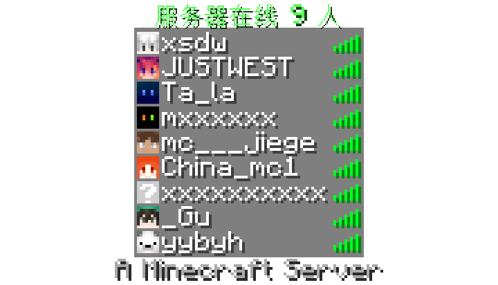
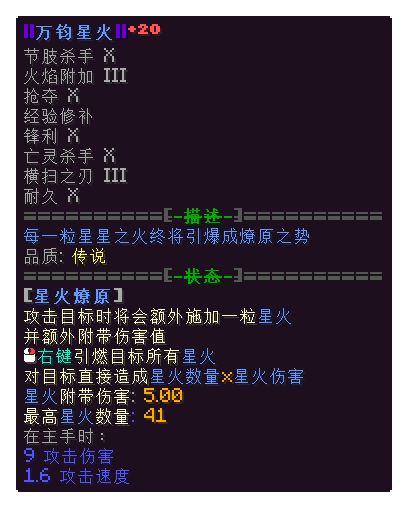
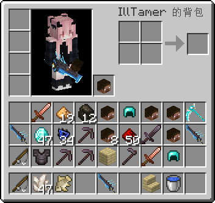
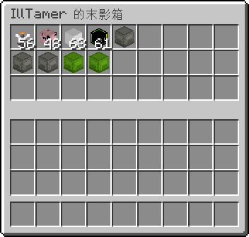

# Minecraft View Generator

<p align="center">
  <strong>面向 Minecraft 1.21.11 的高性能无头 CPU 渲染 HTTP 服务</strong><br />
  将物品图标、容器 GUI、玩家背包、末影箱、Tooltip 与 3D 玩家模型高保真渲染为 PNG。
</p>

<p align="center">
  <a href="https://mvg.illtamer.com/docs"></a>
  <a href="docs/api.md"></a>
  
  
  
  
</p>

---

## 效果预览

| 玩家列表 (playerlist) | 自定义 Tooltip (tooltip) |
| :---: | :---: |
|  |  |

| 玩家完整背包 (playerInventory) | 末影箱界面 (enderchest) |
| :---: | :---: |
|  |  |

---

## 核心特性

- **10 种原版渲染类型**：支持 `item`、`tooltip`、`inventory`、`item_container`、`enderchest`、`playerInventory`、`skin`、`playerlist`、`map`、`achievement`，几何排布、字体度量与配色对齐客户端。
- **纯正原版管线**：Go 负责极简高效编排（零外部依赖），Java 21 无头渲染器直接解析 Mojang 官方 Client JAR 与资源包资产，逐像素还原。
- **完整物品模型系统**：支持 1.21.11 Item Definition、Model Parent 继承、Generated/Handheld、3D Elements、多层纹理、Dispatch 选择器以及九类 Special 模型（旗帜/床/潜影盒/头颅/盾牌/陶罐等）。
- **像素级字体引擎**：运行原版字体管线（space / bitmap / unihex / reference），完整支持 `§` / `&` 样式码、RGB 颜色（`§x...`）与全角汉字 Unifont 点阵渲染。
- **ItemsAdder 自定义物品**：支持通过 `customData`（`custom_model_data` + 原版材质）无缝匹配并渲染 ItemsAdder 资产包中的自定义几何与贴图。
- **动态资源栈热重载**：内置原版、Addon 与用户资源包分层系统，支持在线调整材质包优先级并实时生效。

---

## 快速上手

### 使用 Docker Compose (推荐)

```sh
# 启动服务
docker compose up -d --build

# 准备 1.21.11 官方资源包（首次运行必需，约 500MB）
curl -X PUT http://localhost:4666/api/v1/resources/1.21.11

# 查看资源准备进度（status 为 ready 后即可接收渲染）
curl http://localhost:4666/api/v1/resources/1.21.11
```

服务默认监听 `0.0.0.0:4666`。可直接访问在线交互文档：
- **Scalar 交互式 API 体验**：`http://localhost:4666/docs`（或公开站点 [mvg.illtamer.com/docs](https://mvg.illtamer.com/docs)）
- **OpenAPI 规范定义**：`http://localhost:4666/api/v1/openapi.json`
- **详细参数手册**：[docs/api.md](docs/api.md)

---

## 调用示例

### 1. 渲染物品为 PNG (`item`)

```sh
curl -X POST http://localhost:4666/api/v1/render \
  -H 'Content-Type: application/json' \
  --data '{
    "version": "1.21.11",
    "type": "item",
    "output": "png",
    "data": { "id": "minecraft:diamond_sword", "count": 1 }
  }' \
  -o sword.png
```

### 2. 渲染箱子容器 (`inventory`)

```sh
curl -X POST http://localhost:4666/api/v1/render \
  -H 'Content-Type: application/json' \
  --data '{
    "version": "1.21.11",
    "type": "inventory",
    "output": "base64",
    "data": { "title": "Chest", "rows": 3, "columns": 9, "slots": [] }
  }'
```

### 3. 渲染 ItemsAdder 自定义物品

```sh
curl -X POST http://localhost:4666/api/v1/render \
  -H 'Content-Type: application/json' \
  --data '{
    "version": "1.21.11",
    "type": "item",
    "output": "png",
    "data": { "id": "minecraft:paper", "customData": 1134 }
  }' \
  -o custom_item.png
```

---

## 资源与材质包管理

把材质包 (`.zip`) 放入 `data/resourcepacks/` 即可自动挂载。

```sh
# 查询已加载的材质包与当前优先级
curl http://localhost:4666/api/v1/resources/packs

# 调整材质包优先级（数组越靠后优先级越高）
curl -X PUT http://localhost:4666/api/v1/resources/packs \
  -H 'Content-Type: application/json' \
  --data '{"order": ["Base.zip", "MyPack.zip"]}'
```

---

## 本地编译运行

环境要求：**Go 1.22+**、**JDK 21**。

```sh
# 编译 Go 服务端与 Java 渲染引擎
make build
renderer-backend/build.sh

# 启动服务
./run.sh

# 运行全量测试
make test
make vet
cd renderer-backend && ./test.sh
```

---

## 环境变量配置

所有配置项均通过环境变量读取（可在 Docker Compose 或 `.env` 中覆盖）：

| 变量 | 默认值 | 说明 |
| :--- | :--- | :--- |
| `LISTEN_ADDR` | `:8080` (`run.sh` 为 `0.0.0.0:4666`) | HTTP 监听地址 |
| `DATA_DIR` | `./data` | 资源文件、缓存与配置的持久化目录 |
| `RENDERER_COMMAND` | `./renderer-backend/run.sh` | Java 渲染后端命令 |
| `RESOURCE_PACK_ROOT` | `<DATA_DIR>/resourcepacks` | 用户材质包目录（监听热加载） |
| `RESOURCE_PACK_WATCH_INTERVAL` | `1s` | 材质包目录监听轮询间隔 |
| `CUSTOM_CONTENTS_DIR` | `<DATA_DIR>/contents` | ItemsAdder `contents/` 目录路径 |
| `CUSTOM_ITEMS_CACHE` | `<DATA_DIR>/items_ids_cache.yml` | ItemsAdder 物品 ID 映射表 |
| `API_KEY` | *(空)* | 非空时开启 API Key 鉴权（`X-API-Key` 或 Bearer Token） |
| `MAX_CONCURRENT_RENDERS` | `4` | 渲染并发控制（1–128） |
| `MAX_IMAGE_WIDTH` / `MAX_IMAGE_HEIGHT` | `1600` / `1200` | 画布最大宽高限制 |
| `MAX_RENDER_DURATION` | `15s` | 单次渲染超时时间 |

---

## 许可证

本项目遵循 [MIT License](LICENSE)。
